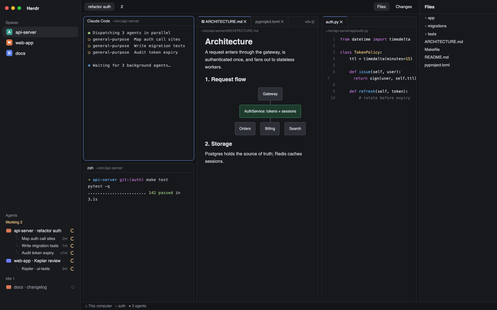

# herdr-ide

A [Herdr](https://herdr.dev) layout for running agent swarms: file tabs in split editor
panes, VSCode-style markdown preview with mermaid diagrams, and each Claude Code / Codex
session's running subagents as a live tree in the agents sidebar.



## Install

Needs Herdr, `python3` and (for diagrams) Node/npm. On a new machine:

```sh
git clone https://github.com/codexceed/herdr-ide.git && python3 herdr-ide/install.py
```

It copies the layout and its five mods into `~/.config/herdr-app`, merges four key
bindings into your `keys.json`, installs `@mermaid-js/mermaid-cli` if `mmdc` is missing,
runs `herdr-app check` on each mod and switches the window to the layout. If Herdr isn't
running (or has never run), it opens on the layout the next time it starts.

- Rerunning updates in place; older copies go to `~/.config/herdr-app/backups/`.
- A key you already use for something else is kept and reported (`--replace-keys` takes it).
- `--no-mermaid`, `--no-switch`, `--no-check`, `--home <dir>` adjust the steps.
- `python3 install.py --uninstall` removes it again and switches back to `main`.

Switch layouts any time with ctrl-shift-l (or Settings → Look).

### Optional: exact Claude sessions

Without a hook, each Claude terminal is matched to the newest session in its folder.
For an exact match when several Claude terminals share a folder, add this to the
`"SessionStart"` list in `~/.claude/settings.json`:

```json
{ "hooks": [ { "type": "command", "command": "python3 ~/.config/herdr-app/mods/ide-agents/claude_hook.py", "timeout": 5 } ] }
```

### What it touches

No network access. The mods run local programs and read outside their folder:

- `ide-editor` reads the files you open and runs `mmdc` + `sips` to render diagrams into
  `~/.config/herdr-app/data/ide-mermaid/`.
- `ide-files` runs `sh` to list folders and `git status` for change marks.
- `ide-agents` runs `python3 swarm.py`, which reads `~/.claude/projects/` and opens
  `~/.codex/*.sqlite` read-only.

## Use

| Do | How |
| --- | --- |
| Open a file as a tab | Click it in **Files** (tab bar → Files) |
| Files side by side | ⌘\\ or the split button in an editor pane |
| Close a file tab | × , middle-click, or ⌘W in the editor pane |
| Markdown preview ⇄ source | ⌘⇧V or the `</>` button |
| Find in a terminal or file | ⌘F: the pane's header turns into a find bar; ↑↓ steps through matching lines, Enter copies one, Esc closes. Editor panes also list every match |
| Split terminals / agents | ⌘D (right), ⌘⇧D (down) |
| Watch a swarm | Subagents appear under their agent while they run |

See [RECIPE.md](RECIPE.md) for exactly what each part does and how it's built.

## Develop

`layouts/` and `mods/` are the installed files. Edit them here, rerun `install.py`, and
check `herdr-app status`. Tests: `python3 -m unittest discover -s tests`.
`preview.png` is rendered from `preview.html` (a mock-up, no real data):

```sh
"$(ls -d ~/.cache/puppeteer/chrome-headless-shell/*/chrome-headless-shell-*/chrome-headless-shell | head -1)" \
  --headless --hide-scrollbars --window-size=1600,1000 --screenshot=preview.png "file://$PWD/preview.html"
```
