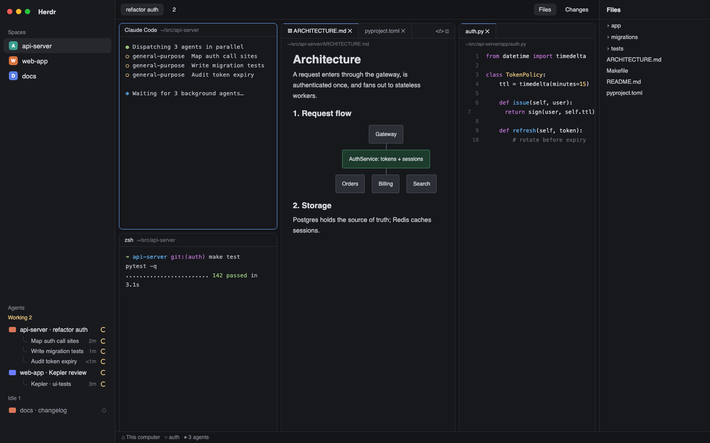

# herdr-ide

Herdr's default window turned into a small IDE for running agent swarms. Files open as
tabs in editor panes that sit in the same split grid as terminals and agents, markdown
renders with mermaid diagrams (⌘⇧V, as in VSCode), and the agents sidebar shows each
Claude Code or Codex session's running subagents as a live tree under it.



## What you see

Left to right, the same frame as Herdr's `main` layout:

- **Sidebar** (268px, folds to a 76px rail on macOS / 44px elsewhere):
  - **Top bar** (`ide-chrome`, 46px): logo, search and the sidebar toggle. Folded on
    macOS, it grows to 78px so the toggle sits under the traffic lights; the toggle is
    always at the top, never at the bottom.
  - **Spaces** (shipped `spaces` mod).
  - **Agents** (`ide-agents`): Herdr's agents list. Grouped by space, a repo with git worktree
    spaces gets a header named after the repo, and each checkout under it (the main one
    first, then every worktree, even a lone one) is an indented subgroup labeled with the
    checkout's folder name after a `folder-git-2` worktree icon, in the theme's `ansi4`
    (blue), then its branch (or short commit when detached) after a `git-branch` icon, in
    `ansi5` (magenta); hovering shows both in full. A repo without worktrees stays one
    plain group. Under each Claude Code / Codex agent,
    its running subagents as tree rows (26px, 12.5px text, `├`/`└` lines in the theme's
    `input` color): the subagent's task, how long it has run (`2m`), and a spinner.
  - **Footer** (`ide-chrome` with `{footer: true}`): Settings, Add machine.
- **Work area**: the shipped tab bar, then the active tab's panes as cards with the
  pane header (`ide-pane`: the shipped `pane` header plus find). Panes can be terminals,
  agents or **editor panes** (`ide-editor`):
  - a 34px tab strip in `chrome` (active tab on `background` with a 1px `accent` top edge,
    a × on each tab), and on the right a preview/source toggle (markdown files only) and a
    split button;
  - a 24px breadcrumb with the file's path (`~/…`);
  - the file as a read-only code view with line numbers and syntax colors, or rendered
    markdown (24px side padding, 14px text in the system UI font) with diagrams as centered
    images.
- **Files panel** on the right (`ide-files`, hidden until the tab bar's Files button):
  the focused pane's folder as a lazy tree with git marks (A / M / D / U).
- Status bar (shipped `workspace-status`).

## How it behaves

- **Agents:** an agent's own status works as in Herdr (working spinner, `Needs you`,
  done dot, idle ring). Subagent rows appear while the subagent runs and **disappear when
  it finishes**; one waiting on its own background work shows the idle ring; a failed one
  shows `Needs you` until it's gone. A running subagent
  counts toward its parent's place in the Working section. Clicking a subagent row
  focuses its parent's pane; hovering shows the full task. The parent's chevron folds the
  tree. The tree refreshes every 3 s.
- **Files → editor panes:** clicking a file opens it as a tab in the editor pane used
  last in the current Herdr tab, or splits a new editor pane to the right of the focused
  pane. A file already open is selected, not duplicated; new tabs go right after the
  active one.
- **Editor panes:** click a tab to show it; × or middle-click closes it; closing the last
  tab closes the pane. The split button or **⌘\\** opens the current file in a new editor
  pane to the right. Tabs survive restarts. The shown file reloads from disk every 3 s.
- **Markdown:** **⌘⇧V** or the `</>` button switches the active editor pane's markdown
  file between source and preview (remembered per file). The preview hides YAML/TOML
  front matter. Each ```` ```mermaid ```` block renders once (≈1–2 s, "Rendering
  diagram…" meanwhile) in the theme's light or dark look, then comes from a cache; a
  broken diagram shows mermaid's error and its source.
- **Keys:** ⌘⇧V and ⌘\\ work while this layout shows (`layout:herdr-ide`); ⌘W closes a
  file tab while an editor pane has the keyboard (elsewhere it still closes the Herdr
  tab). Splits are Herdr's own: ⌘D right, ⌘⇧D down.
- **Find:** ⌘F (`layout:herdr-ide`) turns the focused pane's header into a find bar over
  that pane: query, `3 of 120`, ↑↓ (or the chevrons) to step, Enter copies the line,
  Esc or × closes. Terminals search their screen plus 10,000 lines of history (`hc read`)
  and show the current match's line in the bar; editor panes search the open file and
  list every match under the breadcrumb. Matches are lines, newest first, any case.

## Built from

- `layouts/herdr-ide.json`: a clone of Herdr's `main` with `brand` / `sidebar-footer` →
  `ide-chrome`, `agents` → `ide-agents`, the right panel's `files` block → `ide-files`;
  `"preview": "layouts/herdr-ide.png"`.
- `ide-files`: the shipped `files` mod with its in-panel preview replaced by `openFile()`,
  which edits shared `"ide-editor.groups"` / `"ide-editor.active"` and runs
  `pane.split {direction: "right", mod: "ide-editor", props: {group, seed}}` when no
  editor pane of the current tab is open.
- `ide-editor` (`focusable: true`): a pane mod. Its state is
  `shared("ide-editor.groups")[props().group]` = `{tabs: [{path, on}], active, preview,
  tab, open, used, pane}`; `props().seed` fills a brand-new group. Commands from
  `nextCommand()`: `markdown`, `split`, `close` (acted on only by the group in
  `shared("ide-editor.active")`), `focus`. Uses `EditorState`/`Editor`,
  `TextView.markdown`, `image()`, `readTextFile`, `exec`. Mermaid: `sh -c` runs
  `mmdc -t dark|default -b transparent -s 2` into
  `~/.config/herdr-app/data/ide-mermaid/<hash>.png`, then `sips` for its size.
- `ide-agents`: the shipped `agents` mod plus `swarmKids()` / `swarmRow()`. Every 3 s it
  runs `python3 mods/ide-agents/swarm.py '<json>'` with each live Claude/Codex terminal's
  address, kind and folders (the pane's live `cwd` first, then core's).
  - Claude Code: the terminal's session from `data/swarm/claude-<terminal>.json` (written
    by the optional `claude_hook.py` SessionStart hook), else the newest transcript in
    `~/.claude/projects/<folder>/`; subagents from
    `<session>/subagents/agent-*.meta.json` (`description`, `agentType`, `finished`) and
    the `.jsonl`: running while it ends mid tool call or was written in the last 2 min;
    waiting while the parent transcript's latest `<task-notification>` about it says
    "is waiting on its own background work".
  - Codex: the newest top-level thread for the folder in `~/.codex/state_5.sqlite`,
    children from `thread_spawn_edges` (nickname, `agent_path`), status from the last row
    of `thread_turns` in `thread_history_1.sqlite`; both opened read-only.
  Worktrees: `git rev-parse --git-common-dir` / `--show-toplevel` on each space's
  folder (its first terminal's live `cwd`), as the shipped `spaces` mod does; the branch
  from `git symbolic-ref --short -q HEAD`, else `git rev-parse --short HEAD`.
- `ide-chrome`: the shipped `workspace-chrome` with `fitBrand()` resizing `brand`.
- `ide-pane`: the shipped `pane` header plus a find mode. `ide-pane.find` reaches every
  header; the focused pane's opens. It keeps `shared("ide-find")` = `{[pane]: {query, at,
  matches?}}`, one entry per open bar; for an editor pane `matches` carries each line cut
  around the hit, which `ide-editor` draws as its list. Each load or close bumps a
  generation, so a read that finishes late is dropped; an editor bar reloads when the
  editor's active file changes.
- Programs: `mmdc` (`@mermaid-js/mermaid-cli`), `python3`, `sips` (macOS), `sh`.
  Icons: its own SVGs plus the shipped `workspace-chrome` icons used by `ide-agents`.

## Watch out

- A pane mod's `props()` holds only what it was opened with, not its pane id, and
  `pane.split` returns nothing to a mod (`panes()` catches up later). The editor names
  itself with a `group` prop and learns its pane from `focused()` after a click, or as the
  one editor pane in its tab that no other open group owns. It never takes an owned pane.
- Geist, the default UI font, has no bold or italic faces: the markdown preview uses
  `.SystemUIFont` so `**bold**` and `*italic*` show.
- Herdr routes a mouse-up over another pane away from the preview, so a selectable
  `TextView` can be left mid-drag and select on hover. Only the focused pane's preview is
  selectable, and leaving the pane remounts its text. The selection itself is drawn in the
  theme's `selection` color over the text; a mod can't restyle it.
- A mod pane has no folder: while an editor pane has focus, Files keeps showing the
  folder of the tab's last focused terminal.
- `shared.json` edited on disk doesn't reach a running app: seed new editor panes
  through `props.seed`, not the file.
- Core's terminal `cwd` can be where the shell started, not the agent's folder; match
  Claude sessions on the pane's live `cwd` too.
- `mmdc` needs a browser: npm may block puppeteer's postinstall, so install
  `chrome-headless-shell` with `npx puppeteer browsers install` from mermaid-cli's
  folder. Render to PNG: SVG labels use `foreignObject`, which the image loader drops.
- A Claude subagent's `finished` is set at every turn end and stays set after a revive,
  and a long tool call writes nothing until it returns: neither silence nor `finished`
  alone says it stopped. Silent 2 minutes outside a tool call counts as stopped; running a
  tool or waiting for 6 hours, like a Codex thread open that long without a finished turn,
  counts as orphaned.
- Diagram sizing uses `sips`, so mermaid previews are macOS-only as built.
- Without the Claude hook, two Claude terminals in the same folder show the same
  session's subagents.
- `flex_shrink(value)` needs a number (`flex_shrink_1()` doesn't); `herdr-app check` won't
  catch it in rows that only draw once the git answer arrives — look at the window.
- Editor panes are read-only; tabs can't be dragged between panes.
- Find can't jump: Herdr has no API to scroll a terminal or the code view, or to place a
  popup over a pane, hence a bar in the pane's header and Enter copying the line.
- Never cut a JS string inside a surrogate pair: half an emoji is invalid UTF-8 and the
  frame fails to draw ("Conversion from string failed").

## Done when

- `herdr-app check` passes for `ide-files`, `ide-editor`, `ide-agents`, `ide-chrome`,
  and `herdr-app status` shows no errors after `layout.switch {name: "herdr-ide"}`.
- Clicking two files in Files opens one editor pane with two tabs; ⌘\\ adds a second
  pane to its right showing the same file.
- A markdown file with a ```` ```mermaid ```` block shows the diagram after ⌘⇧V, and
  ⌘⇧V again shows the source.
- Asking Claude Code to run three background subagents shows three spinner rows under
  that agent within 3 s, and each row disappears when its subagent finishes.
- Folding the sidebar keeps its toggle at the top, with nothing at the bottom of the
  agents list.
