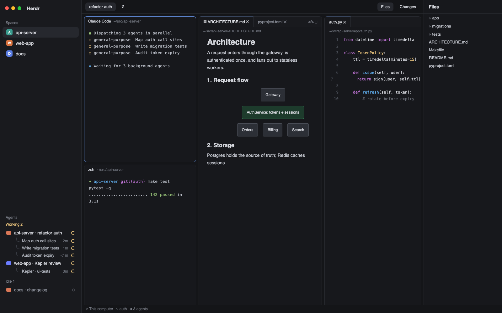

# herdr-ide

Herdr's default window turned into a small IDE for running agent swarms. Files open as
tabs in editor panes that sit in the same split grid as terminals and agents, markdown
renders with mermaid diagrams and HTML renders as a page (⌘⇧V, as in VSCode), and the agents sidebar shows each
Claude Code or Codex session's running subagents as a live tree under it.



## What you see

Left to right, the same frame as Herdr's `main` layout:

- **Sidebar** (268px, folds to a 76px rail on macOS / 44px elsewhere):
  - **Top bar** (`ide-chrome`, 46px): logo, search and the sidebar toggle. Folded on
    macOS, it grows to 78px so the toggle sits under the traffic lights; the toggle is
    always at the top, never at the bottom.
  - **Spaces** (shipped `spaces` mod).
  - **Agents** (`ide-agents`): Herdr's agents list. Grouped by space, a repo with git worktree
    spaces gets a header named after the repo, and each checkout under it (the main one
    first, then every worktree, even a lone one) is an indented subgroup labeled with the
    checkout's folder name after a `folder-git-2` worktree icon, in the theme's `ansi4`
    (blue), then its branch (or short commit when detached) after a `git-branch` icon, in
    `ansi5` (magenta); hovering shows both in full. A repo without worktrees stays one
    plain group. Under each Claude Code / Codex agent,
    its running subagents as tree rows (26px, 12.5px text, `├`/`└` lines in the theme's
    `input` color): the subagent's task, how long it has run (`2m`), and a spinner.
    Right-clicking an agent row opens its menu: **Rename tab** (`tab.rename`, which asks for
    the name; the row shows the tab's name), or **Rename** (`pane.rename`, this agent's pane
    alone; the row shows `pane_name`) once Herdr has it (after 0.1.16), and nine colors plus
    none. The color is the agent session's own, so agents sharing a tab can differ. Rows sit 4px apart (2px
    margin each). Every row has a 1.5px border (2px when focused): white at 30%, or its color at 50%. The focused row gets the border
    at full strength, an opaque fill (the color at 14% over `chrome`, white at 9% for an
    uncolored tab) and a halo: two rings of the color at 25% and 10%, drawn with a
    negative margin so the rows around it don't move.
    An agent on another machine gets a 42px row: its name, then the machine under it
    (10.5px, `dim`, after the shipped `monitor` icon); both truncate.
    Sub-agent rows take their parent agent's color: a 1.5px border and tree lines at the
    parent's unfocused strength.
    Agents that share one screen (neighbours in the same tab, `byTab()`) sit in a dashed
    soft white box (each row keeps its own color), headed by a split-panes icon and "N panes, one view"; the
    list keeps an 18px right gutter so the scrollbar, drawn over the content, misses the rows.
    Collapsed to the rail (sidebar under 160px), each agent is its icon and status in its
    tab's border; resting the pointer on one for 250ms opens a `HoverCard` beside it with the
    full row and its sub-agents, clickable like the list.
  - **Footer** (`ide-chrome` with `{footer: true}`): Settings, Add machine.
- **Work area**: the shipped tab bar, then the active tab's panes as cards with the
  pane header (`ide-pane`: the shipped `pane` header plus find). Panes can be terminals,
  agents or **editor panes** (`ide-editor`):
  - a 34px tab strip in `chrome` (active tab on `background` with a 1px `accent` top edge,
    a × on each tab), and on the right a preview/source toggle (markdown and HTML files only), an open-in-browser
    button (HTML files only) and a split button;
  - a 24px breadcrumb with the file's path (`~/…`);
  - the file as a read-only code view with line numbers and syntax colors, or rendered
    markdown (24px side padding, 14px text in the system UI font) with diagrams as centered
    images, or an HTML file as a picture of the page at the pane's full width.
  - a spreadsheet (`.xlsx`, `.xlsm`, `.gsheet`) as an Excel-style grid (`sheet.js`, data from
    `xlsx_read.py`): a 28px formula bar (cell name, `fx`, the formula or value), 20px column
    letters and row numbers that stay put, frozen panes, merged cells, fills, font styles and
    colors, borders, number and date formats (`#####` when a number doesn't fit), text spilling
    into empty neighbours, auto-fit heights for wrapped rows, hidden rows, columns and sheets
    left out, and 30px sheet tabs (tab colors as a dot). Cells are always Excel's light colors.
    The view draws only what's on screen and scrolls itself (wheel; arrows, Tab, Enter, Page
    Up/Down move the selection); at most 150k cells are read. A `.gsheet` exports through
    Google if the sheet is shared by link, else offers **Open in Google Sheets**.
- **Files panel** on the right (`ide-files`, hidden until the tab bar's Files button):
  the focused pane's folder as a lazy tree with git marks (A / M / D / U). Right-clicking a
  file (or an editor tab) opens a 230×108 popup (`ide-files` with `props.fileMenu`):
  **Download** to `~/Downloads`, or **Download to…** a folder from `pickFolder`. A file on
  another machine comes over `hc exec --on <machine> cat` (byte-exact, up to 10 minutes),
  lands as `.part` first, never overwrites (`name (1).ext`), and a toast says where it went.
- **Go to file** (`ide-open`, ⌘P): a 640px popup hanging 40px from the top, like VS Code's
  Quick Open: a search field, up to 12 rows (file icon, name, then its folder dimmed;
  matched letters in `accent`, a `terminal` / `recent` tag on the right) and a status line
  (`99 files in ~/Repos/x`).
- Status bar (shipped `workspace-status`).

## How it behaves

- **Agents:** an agent's own status works as in Herdr (working spinner, `Needs you`,
  done dot, idle ring). Subagent rows appear while the subagent runs and **disappear when
  it finishes**; one waiting on its own background work shows the idle ring; a failed one
  shows `Needs you` until it's gone. A running subagent
  counts toward its parent's place in the Working section. Clicking a subagent row
  focuses its parent's pane; hovering shows the full task. The parent's chevron folds the
  tree. The tree refreshes every 3 s.
- **Files → editor panes:** clicking a file opens it as a tab in the editor pane used
  last in the current Herdr tab, or splits a new editor pane to the right of the focused
  pane. A file already open is selected, not duplicated; new tabs go right after the
  active one.
- **Editor panes:** click a tab to show it; × or middle-click closes it; closing the last
  tab closes the pane. The split button or **⌘\\** opens the current file in a new editor
  pane to the right. Tabs survive restarts. The shown file reloads from disk every 3 s.
- **Markdown:** **⌘⇧V** or the `</>` button switches the active editor pane's markdown
  file between source and preview (remembered per file). The preview hides YAML/TOML
  front matter. Each ```` ```mermaid ```` block renders once (≈1–2 s, "Rendering
  diagram…" meanwhile) in the theme's light or dark look, then comes from a cache; a
  broken diagram shows mermaid's error and its source.
- **HTML:** ⌘⇧V on a `.html` / `.htm` / `.xhtml` file shows the page as Chrome lays it out
  at the pane's width, in the theme's light or dark `prefers-color-scheme`, after its
  scripts run (≈2 s, "Rendering page…" meanwhile). It is a picture: hover, clicks and
  `<details>` don't respond. Resizing the pane re-renders per 20px of width, showing the
  last render scaled meanwhile; editing the file re-renders on the next 3 s reload. A file
  on another machine is copied here first, so its relative links (CSS, images) don't load;
  a local file's do. Pages taller than 12,000px are cut, with a note.
- **Open in browser** (↗, HTML files, preview or source): opens the file in the default
  browser, for hover, clicks and `<details>`. A remote file opens as the same local copy,
  once its text has been read. A failure posts an error notification.
- **Keys:** ⌘⇧V and ⌘\\ work while this layout shows (`layout:herdr-ide`); ⌘W closes a
  file tab while an editor pane has the keyboard (elsewhere it still closes the Herdr
  tab). Splits are Herdr's own: ⌘D right, ⌘⇧D down.
- **Find:** ⌘F in a terminal is Herdr's own find (`terminal.search`, bound in the
  `terminal` section, which beats `layout:herdr-ide`): a bar inside the terminal that
  searches its screen and history, highlights each hit and scrolls to it; Enter /
  Shift-Enter or its arrows step. In an editor pane ⌘F (`layout:herdr-ide`) turns the
  pane's header into a find bar over the open file: query, `3 of 12`, ↑↓ (or the
  chevrons) to step, Enter copies the line, Esc or × closes, and every match is listed
  under the breadcrumb. Matches are lines, newest first, any case.
- **Go to file:** ⌘P (`layout:herdr-ide`; Herdr's own ⌘P tab picker moves to ⌥⌘P) searches
  the git repo holding the focused terminal's folder (tracked and untracked files, not
  ignored ones), else that folder (`rg --files` or `find`, at most 50,000 files), else the
  space's. An editor pane has no folder, so it uses the tab's terminal. Matching is fuzzy,
  as in VS Code: letters in order, word starts, the file name and runs of letters score
  higher; space-separated words must all match. With no query it lists the files the
  tab's terminals printed (last 2,000 lines, newest first, only ones that exist, any
  folder; a relative path is read from the folder of the terminal that printed it; a
  quoted or backticked path keeps its spaces), then files opened with ⌘P before. A query starting with `/` or `~` is a path:
  Enter opens it wherever it is, or says it's a folder or missing. Enter opens a file
  like a Files click; an editor pane that already exists gets the focus. Herdr gives mods
  no Cmd-click on terminal links ([herdr-app#228](https://github.com/herdrdev/herdr-app/issues/228)),
  so ⌘P, Enter stands in for clicking a path an agent printed.

## Built from

- `layouts/herdr-ide.json`: a clone of Herdr's `main` with `brand` / `sidebar-footer` →
  `ide-chrome`, `agents` → `ide-agents`, the right panel's `files` block → `ide-files`;
  `"preview": "layouts/herdr-ide.png"`.
- `ide-files`: the shipped `files` mod with its in-panel preview replaced by `openFile()`,
  which edits shared `"ide-editor.groups"` / `"ide-editor.active"` and runs
  `pane.split {direction: "right", mod: "ide-editor", props: {group, seed}}` when no
  editor pane of the current tab is open.
- `ide-editor` (`focusable: true`): a pane mod. Its state is
  `shared("ide-editor.groups")[props().group]` = `{tabs: [{path, on}], active, preview,
  tab, open, used, pane}`; `props().seed` fills a brand-new group. Commands from
  `nextCommand()`: `markdown`, `split`, `close` (acted on only by the group in
  `shared("ide-editor.active")`), `focus`. Uses `EditorState`/`Editor`,
  `TextView.markdown`, `image()`, `readTextFile`, `writeTextFile`, `exec`. Mermaid: `sh -c` runs
  `mmdc -t dark|default -b transparent -s 2` into
  `~/.config/herdr-app/data/ide-mermaid/<hash>.png`, then `sips` for its size.
  HTML: `sh -c` finds mermaid-cli's folder from `mmdc`, sets `NODE_PATH` to its
  `node_modules`, and runs `node mods/ide-editor/html_shot.cjs <page> <png> <width>
  dark|light` (puppeteer `headless: "shell"`, 2× scale, `networkidle0` up to 5 s, full-page
  clip) into `data/ide-html/<hash>.png`, keyed by look, width step, file and text; it
  prints the CSS size. A remote file is first written to `data/ide-html/<hash>.html`.
  One render runs per group at a time; `shown` keeps each tab's last finished page.
  Open in browser: `sh -c` reads the `https` handler's bundle id from LaunchServices'
  `com.apple.launchservices.secure.plist` (`python3`, `plistlib`) and runs `open -b` on the
  file (Safari when none is set; `xdg-open` off macOS). Plain `open` would use the `.html`
  owner, often an editor. `notify()` reports a failure.
- `ide-agents` colors: the herdr-core terminal label `herdr-ide.color=#rrggbb`, written by the
  row menu (the mod opened as a popup with `props.tabMenu`) with `hc label` and read from
  `terminals()[i].labels`. Like Herdr's pins (`herdr.pinned`) it follows the session across
  pane moves and clients and ends with it. A label that isn't a swatch is ignored
  (`colorFrom()`). Colors from v0.7 (`shared("ide-agents.tab-colors")`, by tab) move onto
  their terminals (`legacyLabels()`); an entry leaves shared state only once its listed agents
  carry the label (`unmovedLegacy()`), so a failed write or an agent on a machine that's away
  is tried again (every 30 s) instead of lost.
  `ide-pane` fills the right 36% of the pane header with the same color, easing in from the
  left to 90% at the edge (48 strips of rising alpha, `alpha ∝ x^1.8`: an element takes only
  solid colors), inset 3–4px so it stays inside the pane's rounded border. `SWATCHES` holds only colors that stand out on a dark
  sidebar (≥ 3:1) and keep white and gray text readable on their tint;
  `tests/agents.test.cjs` checks both.
- `ide-agents`: the shipped `agents` mod plus `swarmKids()` / `swarmRow()`. Every 3 s it
  runs `python3 mods/ide-agents/swarm.py '<json>'` with each live Claude/Codex terminal's
  address, kind and folders (the pane's live `cwd` first, then core's).
  - Claude Code: the terminal's session from `data/swarm/claude-<terminal>.json` (written
    by the optional `claude_hook.py` SessionStart hook), else from
    `~/.claude/sessions/<pid>.json` (Claude Code's record of each running process; `pid`
    from `hc get`), else the newest transcript in `~/.claude/projects/<folder>/` that no
    other terminal already shows; subagents from
    `<session>/subagents/agent-*.meta.json` (`description`, `agentType`, `finished`) and
    the `.jsonl`: running while it ends mid tool call or was written in the last 2 min;
    waiting while the parent transcript's latest `<task-notification>` about it says
    "is waiting on its own background work".
  - Codex: the newest top-level thread for the folder in `~/.codex/state_5.sqlite`,
    children from `thread_spawn_edges` (nickname, `agent_path`), status from the last row
    of `thread_turns` in `thread_history_1.sqlite`; both opened read-only.
  Worktrees: `git rev-parse --git-common-dir` / `--show-toplevel` on each space's
  folder (its first terminal's live `cwd`), as the shipped `spaces` mod does; the branch
  from `git symbolic-ref --short -q HEAD`, else `git rev-parse --short HEAD`.
- `ide-chrome`: the shipped `workspace-chrome` with `fitBrand()` resizing `brand`.
- `ide-pane` status light: a header whose agent is `done` or `blocked` takes the theme's
  status color (the sidebar dots' blue and red) as an 18% tint and a 2px bottom edge.
  Herdr's pane frame has only `border` and `focus`, so the header is all a mod can light.
  The focused pane's border is `foreground` (white), not `accent`, so it stays white
  whatever accent the find highlight uses.
- `ide-pane`: the shipped `pane` header plus a find mode. `ide-pane.find` reaches every
  header; the focused pane's acts. A terminal's runs `terminal.search` (Herdr's bar); an
  editor's opens the header bar and keeps `shared("ide-find")` = `{[pane]: {query, at,
  matches}}`, one entry per open bar; `matches` carries each line cut around the hit,
  which `ide-editor` draws as its list. Each load or close bumps a
  generation, so a read that finishes late is dropped; an editor bar reloads when the
  editor's active file changes.
- `ide-open` (`place: none`; `mod.json` overlay = popup at the top, 640×470): opened by
  `mod.open:ide-open`, so it reads where ⌘P was pressed from `focused()` / `panes()` when
  it opens. Ranking is an fzf-style alignment per path (16 per letter, +10 after `/`, +8
  after `-_. `, +7 for camelCase, +6 in the file name, +4 per letter in a run, −3 to open
  a gap and −1 per skipped letter), minus a little per character of the name and path;
  printed files get +12 and recent ones +6. Herdr stops a render after 50 ms and a task
  resumption after 500 ms, and a path costs ~30 µs (~0.6 ms for a 125-character path and a
  six-word query), so ranking runs in a task, in batches that end after 20 ms
  (`BATCH_MS`) with `cx.sleep(0)` between; an alignment over 32,768 cells uses a greedy match; render only reads finished rows, a newer query
  abandons the old one, a longer one re-ranks only the last one's matches, and Enter during
  a search opens its best file once it ends. It opens files
  with a copy of `ide-files`' `openFile()` (plus `pane` for the split and `pane.focus` for an
  existing group) and keeps the last 30 in `shared("ide-open.recent")`.
- Programs: `mmdc` (`@mermaid-js/mermaid-cli`), `python3`, `sips` (macOS), `sh`.
  Icons: its own SVGs plus the shipped `workspace-chrome` icons used by `ide-agents`.

## Watch out

- A pane mod's `props()` holds only what it was opened with, not its pane id, and
  `pane.split` returns nothing to a mod (`panes()` catches up later). The editor names
  itself with a `group` prop and learns its pane from `focused()` after a click, or as the
  one editor pane in its tab that no other open group owns. It never takes an owned pane.
- Geist, the default UI font, has no bold or italic faces: the markdown preview uses
  `.SystemUIFont` so `**bold**` and `*italic*` show.
- Herdr routes a mouse-up over another pane away from the preview, so a selectable
  `TextView` can be left mid-drag and select on hover. Only the focused pane's preview is
  selectable, and leaving the pane remounts its text. The selection itself is drawn in the
  theme's `selection` color over the text; a mod can't restyle it.
- A mod pane has no folder: while an editor pane has focus, Files keeps showing the
  folder of the tab's last focused terminal.
- `shared.json` edited on disk doesn't reach a running app: seed new editor panes
  through `props.seed`, not the file.
- Core's terminal `cwd` can be where the shell started, not the agent's folder; match
  Claude sessions on the pane's live `cwd` too.
- `mmdc` needs a browser: npm may block puppeteer's postinstall, so install
  `chrome-headless-shell` with `npx puppeteer browsers install` from mermaid-cli's
  folder. Render to PNG: SVG labels use `foreignObject`, which the image loader drops.
- A Claude subagent's `finished` is set at every turn end and stays set after a revive,
  and a long tool call writes nothing until it returns: neither silence nor `finished`
  alone says it stopped. Silent 2 minutes outside a tool call counts as stopped; running a
  tool or waiting for 6 hours, like a Codex thread open that long without a finished turn,
  counts as orphaned.
- Diagram sizing uses `sips`, so mermaid previews are macOS-only as built.
- Mods have no web view and `TextView.html` drops CSS and SVG, so an HTML preview is a
  headless-Chrome screenshot: no interaction. The page starts in a 100px-tall viewport so
  its height is its content's; a page sized in `vh` lays out short.
- `data/ide-html/` and `data/ide-mermaid/` are never pruned: each edit or width step adds a PNG.
- Without the Claude hook, two Claude terminals in the same folder show the same
  session's subagents.
- `flex_shrink(value)` needs a number (`flex_shrink_1()` doesn't); `herdr-app check` won't
  catch it in rows that only draw once the git answer arrives — look at the window.
- Editor panes are read-only; tabs can't be dragged between panes.
- Editor find can't jump: Herdr has no API to scroll a mod's code view or to place a
  popup over a pane, hence a bar in the pane's header and Enter copying the line.
  Terminals jump because Herdr's own find (0.1.13+) does it.
- A keys.json edited before Herdr 0.1.13 has no `terminal` ⌘F, so ⌘F falls through to
  `layout:herdr-ide`; the installer adds it, and uninstall leaves it (it's Herdr's default).
- Never cut a JS string inside a surrogate pair: half an emoji is invalid UTF-8 and the
  frame fails to draw ("Conversion from string failed").

## Done when

- `herdr-app check` passes for `ide-files`, `ide-editor`, `ide-agents`, `ide-chrome`,
  and `herdr-app status` shows no errors after `layout.switch {name: "herdr-ide"}`.
- Clicking two files in Files opens one editor pane with two tabs; ⌘\\ adds a second
  pane to its right showing the same file.
- A markdown file with a ```` ```mermaid ```` block shows the diagram after ⌘⇧V, and
  ⌘⇧V again shows the source.
- An HTML file with a `<style>`, an inline `<svg>` and a `<script>` that writes text shows
  all three after ⌘⇧V, in the theme's look, both for a local file and one on a machine.
  Its ↗ button opens it in the default browser.
- Asking Claude Code to run three background subagents shows three spinner rows under
  that agent within 3 s, and each row disappears when its subagent finishes.
- Folding the sidebar keeps its toggle at the top, with nothing at the bottom of the
  agents list.
